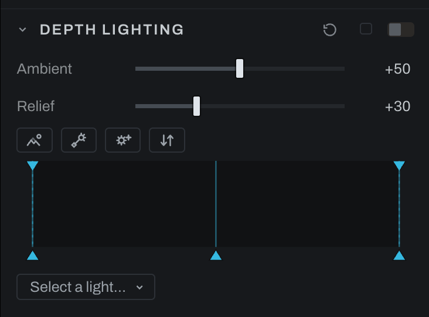

# Depth Lighting

Depth Lighting uses inferred scene depth to relight forms with a movable light rig.

## Controls

- **Light rig** adds, selects, positions, and removes lights. The rig's rings, lines and handle borders take the LINES color every overlay shares, white unless you pick another; the LINES swatch under the rig buttons opens a color picker, as in Grid Warp. How thick the rig draws is the **Thickness** row beside it, the same row Shape Warp has: the **Shape outline thickness** preference under Interface sets it for every photograph and ships at 2 pixels, the number here sets it for this photograph alone, the shape overlays included, and is kept with the photograph as a view setting rather than an edit; **Preference** hands it back. Drag the slider, drag the number itself sideways a pixel at a time, or click the number to type. A handle's fill still says what the light is: amber emitting, near-black dark, or the light's own color. Selected-light controls adjust that light's contribution. A point light's **Depth** can be read from the scene with **From scene**, which sets it to the depth plane's value where the light sits, so a lamp placed on a streetlamp stands at the streetlamp's distance.
- **Levels** shapes the depth map as Depth Lighting reads it, with the widget a layer's Depth mask carries: below Black is the far floor, above White the nearest relief, Gamma bends the depths between, and the falloff handles on the top edge soften either end so the cut does not draw a matte line. This section only. Pull Black up and White down and the soft step the model draws around a subject becomes a hard one, which takes the bright or dark band off the background along the silhouette.
- **Color** tints a light. An emitting light adds its color where it reaches; a dark light, one with a negative Strength, darkens in its color, so a red dark light leaves a red shade rather than a cyan one.
- **Strength** runs from -100 to 100; 100 is three times the light. It only adds: a light brightens where it reaches and leaves what it does not reach at its unlit value, and a negative Strength takes light away by the same shape, most where the light would land hardest. A directional light lands hardest on the plane its Depth names, the near relief unless you move it. A point light or a spot lands its light on what it reaches the way a real lamp does: the same lamp shows strongly on a dark street at night and only a little on a sunlit wall, because what it adds is the surface's color in its light, not a multiple of the light already there.
- **A directional light** is a sun: one direction over the whole scene, with no place of its own. The target you drag on the photograph sets where it shines from, not a spot it is aimed at. Its three dials:
  - **Elevation** is how high it stands over the scene, from 5 to 90: at 90 it shines straight in from the camera, and lower it rakes across the relief from the side. The handle's distance from its target on the photograph sets the same number.
  - **Depth** is the plane it lands hardest on, 0 the nearest thing in frame and 100 the farthest. At 0 it favors the near relief, as a directional light always has; raise it to light the middle distance or the background. **From scene** sets it to the depth under the light's target.
  - **Reach** is how far it carries along depth from that plane. 50 is the falloff it always had, down to about a third at the far end of the scene; 100 lights every plane alike; toward 0 it keeps to its own plane and leaves the rest unlit.
- **A point light** is a lamp in the scene. **Depth** is where it stands along the near-far axis, with **From scene** to read it from the spot the lamp sits on, and **Reach** is how far its push carries, which the ring around it on the photograph also sets.
- **A spot light** is a lamp aimed at something, lighting only inside its cone. On the photograph it is a disc where the lamp sits and a diamond where it points, joined by a line; drag either. The outline around the diamond is where the cone meets the plane of its target, with the full-strength part of the beam dashed inside it. Its dials:
  - **Depth** is where the lamp stands along the near-far axis, and **Target depth** the plane it aims at, both 0 the nearest thing in frame and 100 the farthest, each with **From scene** to read it from the depth under the lamp or under its target. A spot deeper than its target shines back toward the camera.
  - **Cone** is the beam's half angle, from 1 to 89 degrees.
  - **Softness** is how much of the cone its edge takes to fade: 0 is a hard edge, 100 a beam that fades from its center out.
  - **Reach** is how far the beam carries before it fades, as a point light's does.

  Switching a light to a spot keeps it where it was: a point light becomes a spot aimed a little deeper at the place under it, and a directional light becomes a spot standing at its handle, aimed at its target and its Depth.
- **Ambient** is the floor of a directional light's shading: how much of it still reaches surfaces that face away from it. Point lights and spots add only where they reach, so Ambient does not change them.
- **Relief** controls how strongly depth differences are interpreted as shape.
- **View depth** shows the plane itself; **Invert** flips it when the inferred order is reversed. Every section that reads the depth map carries the View depth eye.
- **Normals** is which way the lights take each surface to face. **Depth** estimates it from the depth map's slopes, as Depth Lighting always has. **Model** asks a second model, MoGe-2, which reads the surfaces in the photograph directly: a wall stays one flat plane, a round subject shades round to its edge, and a silhouette draws no bright or dark rim, though fine relief such as a face's features comes out softer than the depth map's. The model is a separate download (141 MB), asked for the first time you choose Model, and reads each photograph once for each Source develop, in about a second; until it has, and on a computer without it, the lights shade from the depth map. Where the model sees no surface, such as the sky, the depth map's estimate is used there too. Relief does not change the Model normals' direction. For an OpenEXR that carries a normals pass, **File** shades with the render's own surface normals when the file also says which way its camera faces (when it does not, the section says NO CAMERA IN THE FILE), **Camera** takes the pass as camera space already, the way a compositor's Vector Transform writes it, and **Off** shades from the depth map alone. With the render's normals the relief is the geometry's, not an estimate, and Relief no longer applies to the shading's direction.

### Backlighting

A light behind a subject, aimed back toward the camera, does not draw a rim of light around it. The depth map describes only the surfaces that face the camera, so no surface in it faces a light that sits behind it: a spot placed deeper than the subject and aimed through it lights nothing on the subject, and raising Relief or Ambient does not change that. For light along an edge, place a spot level with the subject, or a directional light at a low Elevation, to one side: it lights the flank and the edge that face it and leaves the front darker.

Begin with one light and moderate Relief. Position it in the on-image rig, then use Ambient to keep unlit regions from collapsing. Add lights only when one source cannot describe the intended result.

A depth pass from the file is shaded exactly. When the photograph is an OpenEXR carrying a Z or mist pass, the Depth Map reads the renderer's own depth instead of inferring it, and this section shades that plane as measured: every surface shades from its own slope to its last pixel, silhouettes stay one pixel wide, and there is no smoothing between a thing and what stands behind it. The model's map keeps its smoothing, which is what makes a guessed map usable. Edges or Flatten above zero in the Depth Map section smooth a file's pass too, and the section then shades it along the smoothed path; the clips and this section's Levels do not.

Depth is inferred from the photograph, not reconstructed geometry. Watch silhouettes and overlapping objects for halos: the Depth Map section's Edges control takes them off, and Flatten calms a rippling wall. The relief shading itself runs to the last pixel of each surface, and the model's own soft step between a near thing and a far one takes the shading of what surrounds it rather than a seam of its own; this section's Levels can narrow that step. The shading reads the shape of things at the scale of a head or a fold, not the ripples the model draws in hair, cloth and pavement: a surface flatter than the model can resolve reads as flat, so a lamp placed low over the ground shades the ground evenly rather than in blotches. Relief now shows on surfaces it used to leave flat; lower it if a subject reads too sculpted. Reduce Relief when depth errors remain visible. A very strong dark light rolls off toward black on the flanks that face it rather than clipping.

## Lens Flare

The Lens Flare section, below Depth of Field, draws the lens's flare for the rig's lights, the
photograph's own bright spots, or both: the source glow, diffraction rays, the chain of aperture ghosts across the frame,
an anamorphic streak, and the veiling glare that lifts the blacks around a
bright source. Nothing is painted; every element is drawn from the light's
position and the lens's character, so moving the light moves the flare and
the flare renders fresh at every size, in the export included.

- **Sources** chooses where the flare comes from. **Rig lights** flares the
  Depth Lighting lights with their flare switch on. **Bright spots** finds the
  photograph's own light sources, street lamps, headlights, a sun in frame, and
  flares them with no Depth Lighting and no lights placed. Both can be on.
  A flare from an earlier version opens with Rig lights alone and looks as it
  did.
- **Bright spots** has four dials of its own, shown while it is on.
  **Threshold** is how bright a spot must be, in stops above the photograph's
  middle brightness, so it means the same at any exposure: raise it until only
  the real lights are left. **Sources** is the most spots that flare (1 to 16),
  the brightest first, ranked by brightness times size. **Min size** ignores
  spots narrower than a share of the frame's short side, the small glints off
  chrome and water. **Spot strength** sets how strongly the found spots flare
  against the rig's lights. The spots found are listed below the rig's lights,
  brightest first, each with its own switch: switch off one that should not
  flare, a white shirt or a patch of snow, without raising the threshold. A
  spot switched off stays off while you move the dials. The spots are found
  once per photograph, on the picture as it stands before the Tone Profile,
  and found again when an edit before the flare changes it, so the flares sit
  in the same places at every zoom and in the export. The lens presets never
  change the Sources dials. Saturated highlights that are not lights are found
  too; Min size, Threshold and the switches take care of them.
- **Which lights flare** is chosen per light, in Depth Lighting's selected-light
  controls or in the Lens Flare section's list. In the rig, every flaring light
  shows a sun marker where its flare comes from, pinned to the frame edge when
  the source is off-frame, so the aiming handle and the source are never
  mistaken for each other. A directional light flares from
  the frame edge its direction names; its elevation sets how far past the edge
  the source sits. A point light or a spot flares from where it stands.
- **Lens** picks a preset for the look: modern prime, zoom, vintage, telephoto,
  wide, anamorphic, phone. Heeler suggests one from the photograph's focal
  length and lens name but never applies it for you.
- **Anamorphic** is the streak: its strength, thickness, reach and taper, its
  angle, its offset from the source along and across its line, and its
  breakup, the swelling, thinning and clumping a real streak carries along
  its length. Its color is a
  ribbon from the source to the streak's end, below the dials: drag a point's
  handle to place it, click the swatch under it for its color, click the bar
  to add a point in the color found there, click the X above a point to
  remove it, and select a point to set its opacity. Single goes back to one
  color.
- **Occlusion** reads the depth plane two ways. Around the light, something
  nearer than it hides the source and the whole flare dims. Across the frame,
  anything nearer than the light cuts the glow and rays at its silhouette, so
  a flare sits behind a person or a pole rather than being painted over them;
  the ghosts and the veil, which form inside the lens, are not cut. **Veil by
  depth** lets the glare land on the far plane rather than the near one. A
  bright spot takes the depth plane's depth where it was found, so a lamp
  behind a pole loses its glow at the pole's edge just as a rig light does.
  Without a depth map, every source flares in full.
- When Depth of Field is on with a different blade count, the section says so
  and offers **Match**, so bokeh and ghosts share one aperture. It is a click,
  never automatic.

From scene belongs to the selected light. Selecting another light or changing that light while the depth read is pending cancels the answer. Edits to other lights are preserved when the depth arrives.

In the graph the depth arrives by wire, from the Depth Map node's depth output to this node's **depth** input, and asking for depth here adds the wire. With no wire the scene reads as flat, every depth the same, and a Develop section that is asking says NO DEPTH MAP. See [Depth Map](depth-map.md).
