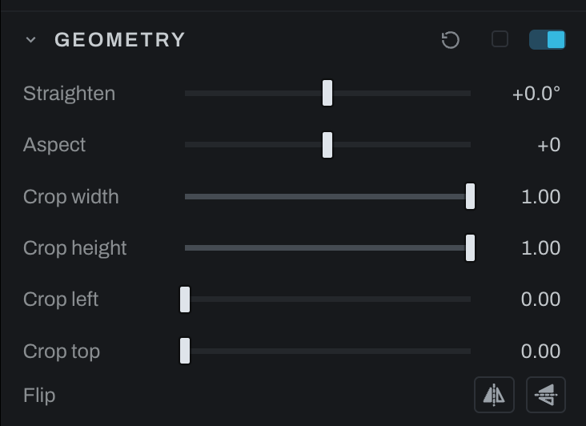

# Geometry

Geometry controls image rotation, aspect transformation, and the nondestructive crop rectangle.

## Controls

- **Straighten** rotates the photograph. Use the viewport tool to drag along a line that should be level.
- **Aspect** stretches the picture: negative values widen it and positive values heighten it. It is not the crop's ratio. To crop to 16:9, 3:2 or another ratio, choose **Photo > Crop / Straighten** and pick the ratio there (see [Image viewport](../image-viewport.md)).
- **Crop width** and **Crop height** set the retained size.
- **Crop left** and **Crop top** position the retained rectangle.

Geometry starts off, and a photograph carries no geometry node until it is used: switching the section on or making the first crop or straighten drag in the viewport adds it. The viewport crop tool is the normal visual way to edit these values. Numeric rows are useful for matching crops or entering exact geometry. Pixels outside the crop are retained and can be restored.

## Crop to picture

Straightening turns the photograph inside its frame, which leaves empty corners where the turned picture no longer reaches. **Stay inside picture** keeps the crop clear of them, and it is on by default:

- When **Straighten** changes (the row, the drawn line or the crop tool's rotation ring), the crop shrinks so no empty corner shows, keeping its center and its ratio. A crop that already filled the picture follows it back out, so straightening and then returning to level gives the whole frame again. A smaller crop is left alone until the picture's edge reaches it.
- Dragging the crop or its corners outward stops at the picture's edge.

Turn it off with **Stay inside** on the crop bar or on the **Crop** row at the foot of this section, and the crop stays wherever it is put. Flip and Rotate's quarter turns leave no empty corners and never change the crop. A document opens exactly as it was saved: the setting only acts on a new change of angle.

**Crop to picture** (**Crop to picture** on the crop bar, **To picture** on the **Crop** row) sets the largest crop that is all picture at the current angle, centered, in the ratio the crop bar holds, or else in the crop's own ratio. It is one undo step, and grays when the crop already is that.

## Flip

**Flip** (two buttons on the **Flip** row at the foot of the section: Flip Horizontal, a shape and its mirror across an upright dashed line, and Flip Vertical, across a level one) mirrors the photograph left for right or top for bottom, the same two switches as **Photo > Flip Horizontal** and **Flip Vertical**. A lit button is on; pressing it again puts the photograph back. Each press is one undo step. The same two buttons sit on the Crop & Rotate node in the graph inspector.

The edits flip with the photograph. A brush stroke, a selection, a radial or linear mask, a Smart selection's clicks, the crop's rectangle and angle, Grid Warp and Shape Warp, Depth Lighting's lamps and every Finish layer all stay on the subject they were made on, so the whole result is the old one mirrored: the export, the view at Fit and at 1:1, the histogram and the thumbnail. A picture placed in Finish mirrors with it (a baked warp's kept warp too, so **Unbake** lands on the mirrored subject), and directions follow: a Gradient layer's angle, a Shadow's or Bevel's light, a motion Blur, a Flare's rays and streak. Grain and the Fog's texture are made fresh where they land and are not mirrored. The flip is applied with the crop, to the photograph before it is turned, so a Smart selection's model and the depth map read the photograph as it is. A depth map computed after the crop is computed again on the flipped frame.

## Rotate

**Rotate** (two buttons on the **Rotate** row under Flip: 90° Left and 90° Right, a picture on its side under an arrow turning that way) turns the photograph a quarter turn, the same as **Photo > Rotate > 90° Left** and **90° Right**; **Photo > Rotate > 180°** turns it upside down. Use it for a portrait shot the camera recorded lying on its side, or a picture taken upside down. Each press is one undo step, and four presses the same way put the photograph back where it started.

The edits turn with the photograph, just as they flip with it: every mask, stroke, selection, the crop's rectangle and angle, the warps, Depth Lighting's lamps and every Finish layer stay on their subject, and a placed picture and the directions (a Gradient's angle, a Shadow's light, a motion Blur, a Flare) turn too. The crop's rectangle turns with the picture, so it frames the same part of the scene; an aspect ratio held in the crop bar reads the turned frame, so a 3:2 crop on a picture turned on its side is 3:2 across the new width. The turn is whole pixels, nothing resampled, and comes after Flip, so on a picture turned on its side **Flip Horizontal** still mirrors it left for right as you see it.

**Paste Edits** carries the flip and the turn with the crop, and **Reset** on this section puts the photograph back the right way round and upright. While the Crop & Rotate node is bypassed in the graph the buttons gray: switch it on first.

## Following the crop

Anything painted or placed on the scene follows a change of crop, in the same undo step: masks, brush strokes, selections, Finish painting, Grid Warp, Shape Warp and the lamps of Depth Lighting stay on the content they were made on (see [Painting and the crop](../finish/README.md#painting-and-the-crop)). Switching Geometry off is a change of crop too.

