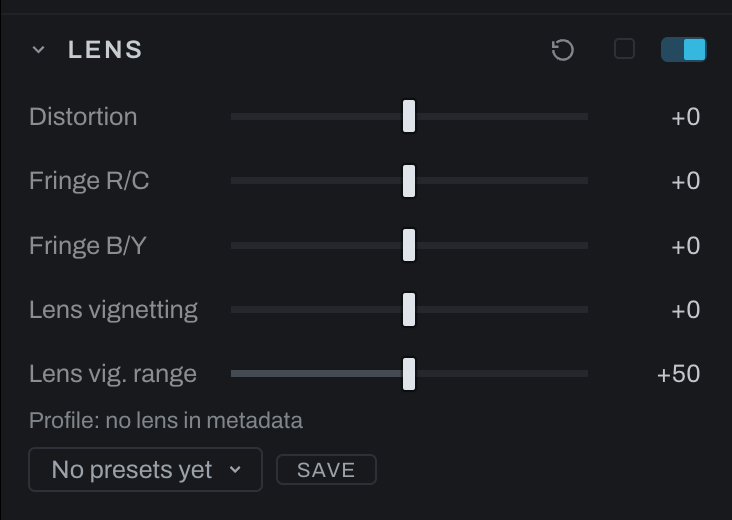

# Lens

Lens corrects geometric distortion, chromatic fringe, and vignetting. Profile support may prefill or guide corrections; the manual controls remain available.

## Controls

- **Distortion** corrects barrel or pincushion curvature.
- **Fringe R/C** corrects red/cyan lateral chromatic separation.
- **Fringe B/Y** corrects blue/yellow separation.
- **Lens vignetting** brightens the corners back up to undo the falloff the lens put there.
- **Lens vig. range** controls how far that correction reaches toward the center.

## Profiles

The profile line in this section names the profile Heeler found for this photograph, and **Apply** writes it onto the controls in one step you can undo:

- **From the file.** Many phones and drones, and some cameras (Google Pixel, DJI, Leica, GoPro and others), write a correction for their own lens into a DNG file. It was made for that camera and lens, so it comes first. A photograph that carries one starts with it on the first time you open it, and the line reads **Profile: from the file**. Switch the section off to see the photograph without it.
- **From the lens database.** Otherwise Heeler looks the lens up in its profile database, and **Apply** writes the distortion, fringe and vignetting the database has for it at the shot's focal length.
- **Your own preset.** A lens preset you saved replaces either of these, since it is the whole lens state.

Correct distortion before final crop because straightening edges can expose empty corners. Inspect high-contrast edges near the frame at 100% while adjusting fringe.

The controls here undo what the glass did. For a falloff you want, use [Vignette](vignette.md), and correct first: working the other way makes this correction fight a look you chose.

