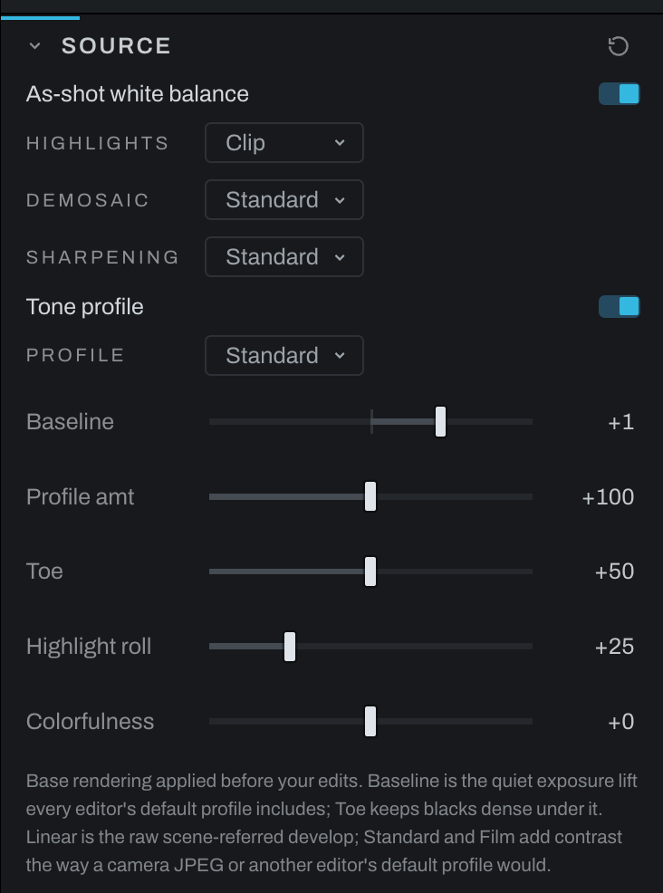

# Source

Source controls raw decoding and the base tone rendering applied before creative adjustments. It is always present and has no enable switch.

## Raw controls

Highlights, Sharpening and Profile are dropdown menus, all one width. Click one, or focus it and press the Down arrow, to open its list; the arrow keys move through the choices, `Return` (`Enter` on Windows) picks one, and `Escape` closes the list unchanged. Resting the pointer on a choice shows what it does in the status bar.

- **As-shot white balance** uses the camera's recorded white-balance multipliers. Turn it off when you want the later Color section to begin from a neutral decoder state: the photograph then develops in daylight balance, the balance the camera's own color response gives a daylight scene. Canon's sRAW, the smaller RAW sizes of Sony and Nikon cameras and Sony's pixel shift files record the camera's balance in their samples, so for those the switch changes nothing.
- **Highlights: Blend** (the default) fills a blown channel from the channels that survived. A blown sky stays neutral, white rather than pink, and pulling Exposure or Highlights down brings back what the other channels saw, such as the shape of clouds.
- **Highlights: Clip** cuts blown sensor channels at white. Blown areas stay neutral too, but they are flat: pulled down, a blown sky turns an even gray.
- **Sharpening** is capture sharpening: a small-scale detail correction applied while decoding sensor RAW data. **Standard** is the initial choice unless you change the import preference; **Low** is lighter, for soft subjects and high ISO; **High** is crisper, for landscapes and architecture at base ISO; **Off** shows the RAW as the demosaic leaves it. A newly imported RAW starts at the choice in **Preferences > Import & Files > RAW default sharpening** (Standard unless you change it); changing that preference never changes a photograph that already has edits, and one edited before Sharpening existed reads as Standard.

## Tone profile

The **Tone profile** switch shows whether the profile is on. A RAW opens with it on. A JPEG or other finished picture, a phone DNG that carries its own rendering, a DNG baked by Heeler and a stack or panorama of finished pictures open with it off, because their picture already carries a look; the profile's controls step aside while it is off, and switching it on brings them back and adds the profile on top.

- **Linear** is a scene-referred raw development without a display-style contrast profile.
- **Standard** applies a conventional camera/editor starting profile.
- **Film** applies a more film-like base contrast.
- **Custom** applies your own curve: see [Custom profiles](#custom-profiles). Profiles you have saved are listed under it, by name.
- **Baseline** sets the quiet exposure lift applied before later edits.
- **Profile amt** controls profile contrast in Standard, Film and Custom and is hidden in Linear.
- **Toe** keeps blacks dense under the baseline lift.
- **Highlight roll** compresses bright values into the display range.

### Custom profiles

Custom draws its own base curve instead of Standard's or Film's. Choosing **Custom** starts from the Standard curve, so nothing changes until you move a point, and shows the curve editor under the menu.

The curve runs from scene light, left to right, to the display value, bottom to top. The scene axis is in stops around middle gray: 0 is middle gray, +1 twice its light, -1 half, and the dashed line near +2.5 is scene white, where the Linear profile clips. A curve can reach past scene white and bring those highlights back under it, which is how a curve can carry its own shoulder. The faint line is Linear, for reference. Past the first and last points the curve holds their values.

- **Drag** a point to move it (a press near a point takes it, as in Curves); **click** an empty place to add a point there; **Ctrl-click** (**Cmd-click** on a Mac) an inner point to remove it, as in Curves (the two end points stay). Points keep a quarter stop apart.
- **Shape**: the button beside it switches between **Smooth**, which bends through the points the way the Curves section does, never overshooting them, and **Linear**, which joins them with straight lines; it is the same button Curves wears. The reset button after it puts the curve back to the Standard curve Custom starts on, keeping its name.
- **Profile amt** mixes your curve with Linear: 100 is the curve as drawn, 0 is Linear, and above 100 goes further than the curve. **Baseline** moves the scene along the curve before it applies, and **Colorfulness** applies after it, as in the other profiles. **Toe** and **Highlight roll** step aside while Custom is chosen: the curve is its own toe and shoulder.

The curve is saved in the photograph's edit, every point of it, so the photograph renders the same on another computer that has never seen the profile file.

**Save** keeps the curve as a profile under the name in the field beside it, and the profile is then listed in the Profile menu, in every photograph. Saving under a name already used replaces that profile. Choosing a saved profile copies its curve into the photograph; changing a point afterwards changes this photograph only, and the menu then shows Custom.

**Import…** reads a curve from:

- a tone profile file (`.heelerprofile`, or `.yaml`), which is also added to your profiles;
- a 1D `.cube` LUT, read as display values in and out, the way the LUT node reads a 3D one; the three channels are averaged into one curve, and a 3D `.cube` is refused (use the LUT node for it);
- a plain text file (`.txt` or `.csv`) of two columns, stops then display value, one point a line, separated by spaces, tabs or a comma, with `#` starting a comment;
- the tone curve (the ProfileToneCurve tag) of a DNG or a DNG camera profile (`.dcp`).

A curve read from a LUT, a long text file or a DNG is sampled every half stop from 8 stops under middle gray to the top of its range. It is set on the photograph; use **Save** to keep it as a profile. **Export…** writes the curve to a `.heelerprofile` file wherever you choose, to share.

#### Profile files

Your profiles live in a `profiles` folder in Heeler's app data, beside `presets` and `recipes`, one file per profile. A profile file is YAML you can read and edit in any text editor; Heeler reads the folder again when the Profile menu opens:

```yaml
# Heeler tone profile: a curve for the Tone Profile's Custom mode, from
# scene light in stops around middle gray to a display value from 0 to 1.
heeler_profile: 1
name: Soft Fade
interp: smooth
points:
  - [-8, 0.03]
  - [-2, 0.2]
  - [0, 0.44]
  - [2.4739, 0.98]
```

- `heeler_profile` is the format's version. A profile from a newer Heeler is refused with a message.
- `name` is the name the menu shows.
- `interp` is `smooth` or `linear`.
- `points` are `[stops, display]` pairs: stops around middle gray (within 24 of it), display from 0 to 1. Two at least, no two at the same stop; their order does not matter.

A file that cannot be read is left out of the menu.

A phone's DNG, such as an iPhone ProRAW, opens with the Tone Profile off. The file carries its own rendering (an exposure shift, a local tone map and a contrast curve), Heeler follows it while decoding, and the photograph opens close to the picture its thumbnail shows; brightness and color can still differ a little from the phone's own preview, most in very saturated scenes. The newer DNG 1.7 form of the tone map is not read yet: a file carrying only that develops as an ordinary RAW, and one carrying both uses the older map.

Phones differ in how much of the rendering their files carry. An iPhone's ProRAW and a Pixel's DNG carry the contrast curve too, so they open with the Tone Profile off. A Samsung Expert RAW carries the exposure shift and the tone map and no curve of its own: Heeler follows what is there and leaves the Tone Profile on to supply the contrast. A Pixel's file also carries a color look table that Heeler does not read, so its color can differ from the phone's more than an iPhone's does. Edit from there as you would any photograph; switching the profile on adds its lift and contrast on top. A camera's DNG is developed like any other RAW.

Capture sharpening works on brightness only, so no edge changes color and color noise is not sharpened. It reaches about one sensor pixel, the scale of the detail a RAW loses, over an edge-aware base, so texture gains and a high-contrast edge does not ring. It measures the photograph's own noise in its smoothest places and leaves differences smaller than that alone, so a high ISO frame sharpens its detail without growing its grain for Noise Reduction to fight. It applies to sensor data only: a linear DNG, such as a Bake to Image result, was sharpened when it was made and is never sharpened again. The Fit preview is sharpened at its own scale, so it shows what the export will. For creative sharpening on top, use the Sharpening section or Detail's Unsharp.

Earlier versions also offered **Highlights: Rebuild** and a **Demosaic** menu (Fast, Standard, Fine). A photograph edited with Rebuild now develops with Clip, and every RAW develops with Heeler's own demosaic, whatever demosaic it was edited with.

Choose the tone profile before building the rest of the look, because it changes the starting contrast under every later section.

Use the [Metadata tab](../metadata.md) for file and camera facts. Graph's source and tone-profile inspectors expose the same operations in node context, the Custom curve editor included. A Custom profile renders on the CPU, as a film stock does, so its previews can take a little longer than the built-in profiles'.



Batch export and Bake to Image apply the same untouched-profile catch-up to a phone ProRAW saved before this rendering change, even if you have not reopened it. A profile you changed stays as you set it.

A Film chosen on a phone's DNG is carried into batch export and Bake to Image just as it is in the viewer.

Merges treat a phone's DNG by what they need. A stack (HDR, mean, median or max) merges the frames scene-linear, before the phone's tone map and curve, because an exposure merge needs light as the sensor counted it; the merged photograph is then developed like any RAW merge, with the Tone Profile on. A panorama stitches the frames as the phone rendered them and opens with the Tone Profile off. A stack or panorama made only of JPEGs (or other finished pictures, such as TIFF or PNG) also opens with the Tone Profile off, as a single JPEG does: the camera's contrast and color are already in its frames. One with a RAW frame in it is developed like a RAW. A JPEG XL DNG with no readable embedded preview uses its developed picture for the thumbnail.
